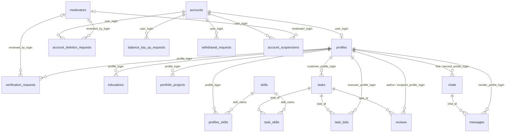
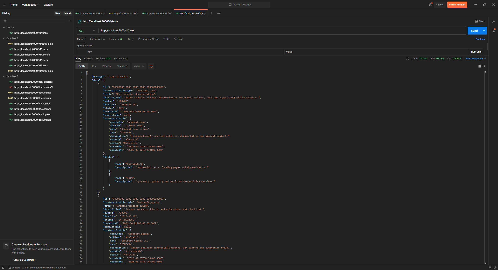
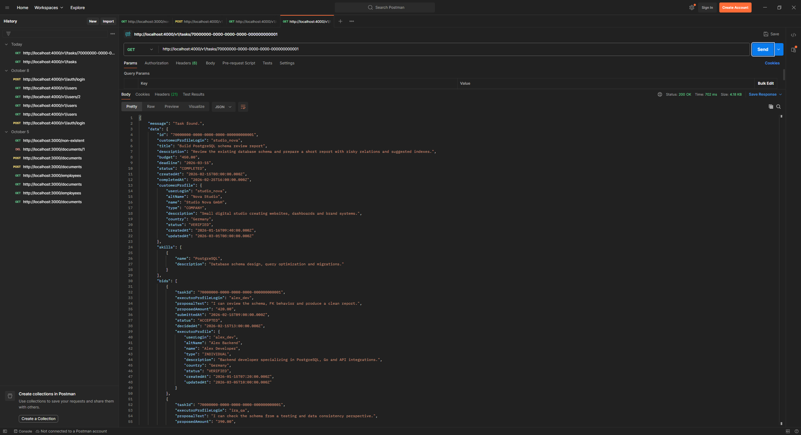
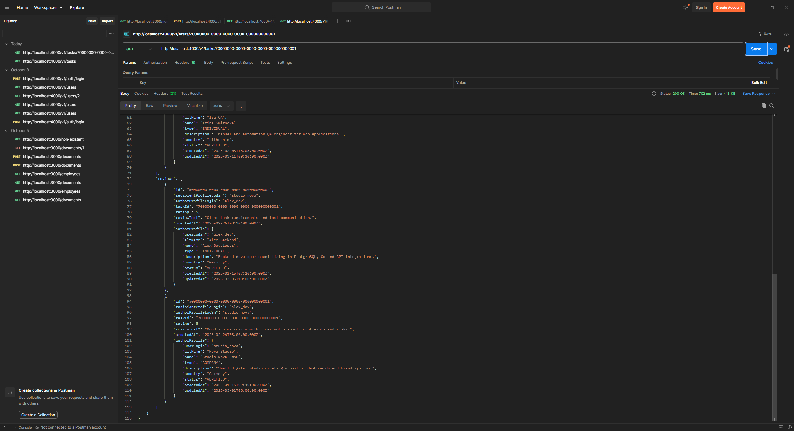
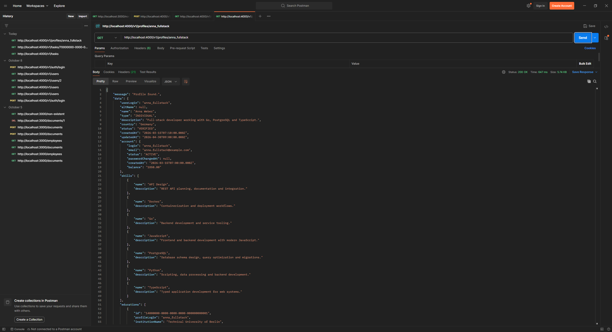
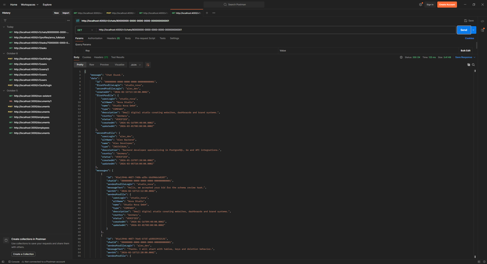
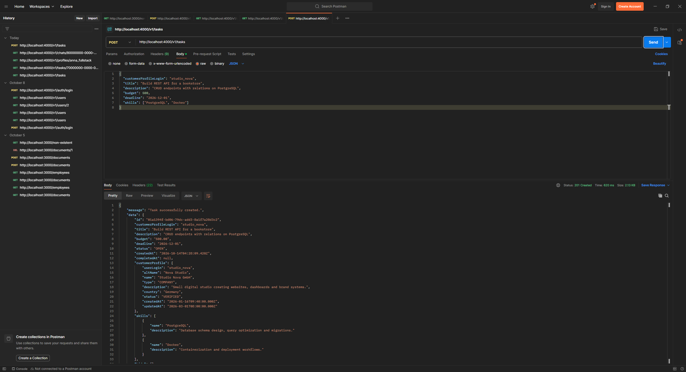
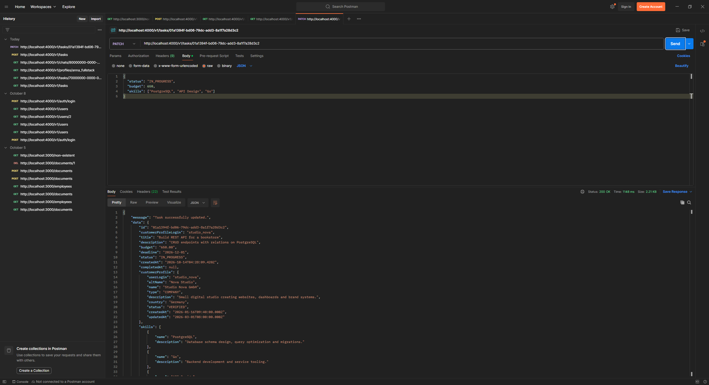
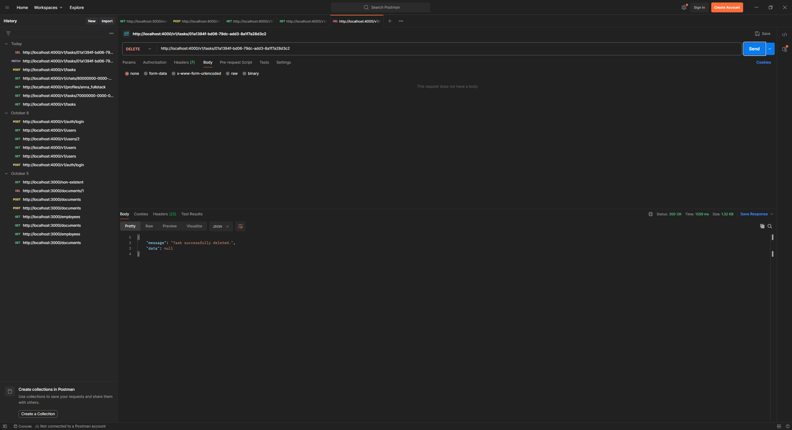
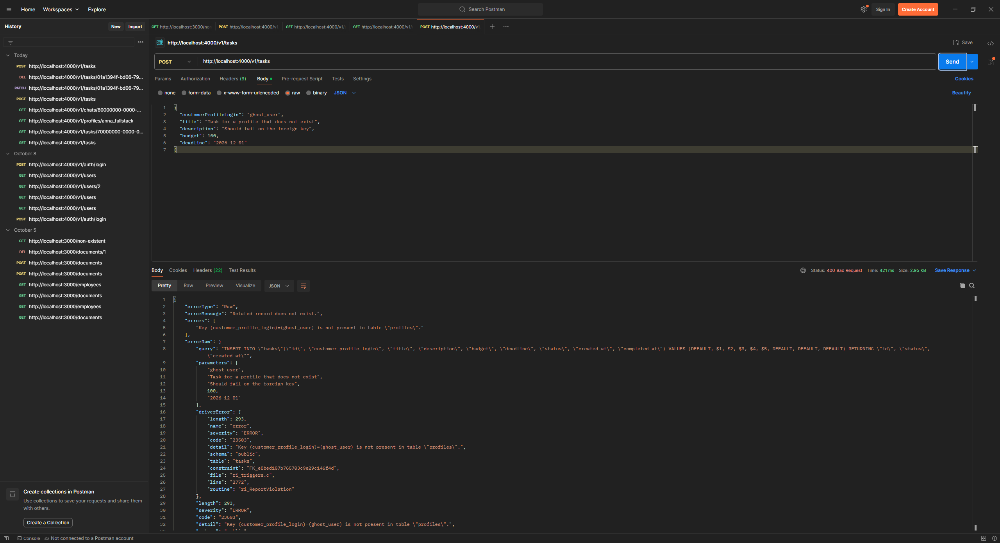

# Лабораторна робота 5

Розширив бойлерплейт з лабораторної 4 ([typeorm-express-typescript](https://github.com/mkosir/typeorm-express-typescript)) сутностями з моєї курсової з проєктування баз даних "Фріланс-біржа". Переніс усі 18 таблиць схеми: користувачів, профілі, навички, завдання, заявки, чати, відгуки, фінансові запити та модерацію. Для кожної сутності є повний CRUD, а GET-запити повертають пов'язані дані через join.

Таблиці, типи, довжини полів, обмеження і каскади такі самі, як у `000001_initial_schema.sql` курсової: ENUM-типи PostgreSQL, ключі UUIDv7 через `uuidv7()` з PostgreSQL 18, натуральні ключі (`login`, `name`) і складені ключі. Одну таблицю перейменував: `users` з курсової тут називається `accounts`, бо таблиця `users` у бойлерплейті вже зайнята авторизацією (вхід і JWT).

Працював з Node.js 24, PostgreSQL 18.3 на моєму сервері і Postman 12.

Запуск

```bash
git clone -c core.autocrlf=false https://github.com/INotSleep/freelance-exchange-api.git
cd freelance-exchange-api
npm install
cp .env.example .env
```

У `.env` треба вказати свою базу PostgreSQL 18 (`PG_HOST`, `PG_PORT`, `POSTGRES_USER`, `POSTGRES_PASSWORD`, `POSTGRES_DB`). Далі міграції, сіди і запуск:

```bash
npm run migration:run:dev
npm run seed:run:dev
npm run dev
```

API слухає `http://localhost:4000/v1`. Можна запустити і в Docker з тим самим `.env`: `npm run docker:remote`.

Сутності та зв'язки



Сутності лежать у `src/orm/entities/freelance`, ENUM-типи в `types.ts`. Види зв'язків:

| Зв'язок                     | Де                                                                                                               | Як зроблено в TypeORM                                                                |
| --------------------------- | ---------------------------------------------------------------------------------------------------------------- | ------------------------------------------------------------------------------------ |
| Один до одного              | `Account` і `Profile`                                                                                            | `@OneToOne` + `@JoinColumn('user_login')`, ключ профілю одночасно є зовнішнім ключем |
| Один до багатьох            | акаунт → фінансові запити, профіль → освіта, портфоліо, завдання; завдання → заявки, відгуки; чат → повідомлення | `@ManyToOne` з `onDelete` / `onUpdate` + `@OneToMany` з іншого боку                  |
| Багато до багатьох          | профілі ↔ навички, завдання ↔ навички                                                                            | `@ManyToMany` + `@JoinTable` (`profiles_skills`, `task_skills`)                      |
| Складений ключ              | `TaskBid` (`task_id`, `executor_profile_login`)                                                                  | два `@PrimaryColumn`                                                                 |
| Необов'язковий зв'язок      | модератор у запитах і блокуваннях                                                                                | `nullable` колонка і `onDelete: 'SET NULL'`                                          |
| Дві посилки на одну таблицю | `Chat` (два профілі), `Review` (автор і отримувач)                                                               | два `@ManyToOne` до `Profile`                                                        |

Міграції

Міграцію згенерував командою `npm run migration:generate -- CreateFreelanceSchema` і прочитав перед запуском. У ній знайшлося дві проблеми TypeORM 0.2, які виправив руками:

- ENUM-типи, які використовують кілька таблиць (`profile_type`, `payment_method`, `request_status`), створювалися по два-три рази. Postgres упав би на другому `CREATE TYPE`. Залишив створення першим, а видалення в `down()` останнім, після всіх таблиць, що їх використовують.
- Для `@OneToOne` TypeORM вимагає окремий `UNIQUE` на `profiles.user_login`, але при створенні таблиці його пропускає. Без нього кожна перевірка `migration:generate` пропонувала зайву міграцію, яка ще й падала на дублікаті зовнішнього ключа. Додав `UNIQUE` у саму міграцію.

Ще одне розходження знайшов теж на етапі читання: зовнішні ключі `skill_name` у зв'язувальних таблицях вийшли без каскадів. Виправив опціями `onDelete` / `onUpdate` з боку `Skill` і перегенерував.

Перевірив `down()` через `npm run migration:revert`: база повернулася до трьох таблиць з лабораторної 4 без жодного ENUM-типу. Після повторного запуску в базі 18 нових таблиць і 9 ENUM-типів, а `migration:generate` відповідає `No changes in database schema were found`, тобто сутності і база збігаються.

Сіди

Дані взяв з курсової (`000002_initial_data.sql`, `000003_task_skills.sql`, `000004_lab3_demo_data.sql`) і поклав у `src/orm/seeds/sql`. Прибрав `BEGIN` / `COMMIT`, бо TypeORM сам виконує міграцію в транзакції, і замінив `users` на `accounts`. Сід-міграція `SeedFreelanceData` виконує ці файли по черзі. Виходить 14 акаунтів і профілів, 14 навичок, 14 завдань, 21 заявка, 6 чатів, 13 повідомлень, 14 відгуків і записи в усіх інших таблицях.

API

Для кожного ресурсу є п'ять ендпоінтів. Читання відкрите, зміни потребують заголовка `Authorization: Bearer ...` з `/v1/auth/login` бойлерплейта.

| Метод  | Шлях                  | Що робить                             |
| ------ | --------------------- | ------------------------------------- |
| GET    | `/v1/{ресурс}`        | список з основними пов'язаними даними |
| GET    | `/v1/{ресурс}/{ключ}` | один запис з усіма пов'язаними даними |
| POST   | `/v1/{ресурс}`        | створення, 201                        |
| PATCH  | `/v1/{ресурс}/{ключ}` | оновлення переданих полів             |
| DELETE | `/v1/{ресурс}/{ключ}` | видалення                             |

| Ресурс                      | Ключ                          | Вкладені дані в `GET /{ключ}`                                                                                             |
| --------------------------- | ----------------------------- | ------------------------------------------------------------------------------------------------------------------------- |
| `accounts`                  | `login`                       | profile, topUpRequests, withdrawalRequests, deletionRequests, suspensions                                                 |
| `profiles`                  | `login`                       | account, skills, educations, portfolioProjects, verificationRequests, tasks, bids з task, receivedReviews з authorProfile |
| `moderators`                | `login`                       | reviewedVerificationRequests, reviewedDeletionRequests, suspensions                                                       |
| `skills`                    | `name`                        | profiles, tasks                                                                                                           |
| `verification-requests`     | `id`                          | profile, reviewedBy                                                                                                       |
| `educations`                | `id`                          | profile                                                                                                                   |
| `portfolio-projects`        | `id`                          | profile                                                                                                                   |
| `account-deletion-requests` | `id`                          | account, reviewedBy                                                                                                       |
| `balance-top-up-requests`   | `id`                          | account                                                                                                                   |
| `withdrawal-requests`       | `id`                          | account                                                                                                                   |
| `account-suspensions`       | `id`                          | account, moderator                                                                                                        |
| `tasks`                     | `id`                          | customerProfile, skills, bids з executorProfile, reviews з authorProfile                                                  |
| `task-bids`                 | `taskId/executorProfileLogin` | task з customerProfile, executorProfile                                                                                   |
| `chats`                     | `id`                          | firstProfile, secondProfile, messages з senderProfile                                                                     |
| `messages`                  | `id`                          | chat, senderProfile                                                                                                       |
| `reviews`                   | `id`                          | task, authorProfile, recipientProfile                                                                                     |

Навички профілю і завдання задаються масивом назв у POST і PATCH, наприклад `"skills": ["PostgreSQL", "Docker"]`. PATCH з новим масивом замінює набір навичок.

Код зроблений у стилі бойлерплейта: для ресурсу є тека в `src/controllers` з файлами `list`, `show`, `create`, `edit`, `destroy` і файл маршрутів у `src/routes/v1`. Контролери поки самі працюють з репозиторієм, сервісний шар і DTO будуть у лабораторній 6. Дві спільні функції:

- `pickFields` бере з тіла запиту тільки дозволені поля, щоб через POST не можна було підставити, наприклад, `id` чи `createdAt`;
- `toCustomError` перетворює помилки PostgreSQL на зрозумілі відповіді: неіснуючий зовнішній ключ 400, дублікат 409, неправильний UUID, ENUM чи дата 400, відсутнє обов'язкове поле 400. Відсутній запис дає 404.

Тестування

Колекцію Postman зберіг у `postman/freelance-exchange-api.postman_collection.json`, у ній 90 запитів. Login зберігає токен, кожна тека містить List, Show, Create і Edit для свого ресурсу, Create запам'ятовує id нового запису, далі йдуть join-запити по створених даних, приклади помилок і тека Cleanup, яка видаляє все створене. Кожен запит перевіряє очікуваний статус. Прогнав колекцію через newman: 90 запитів, 90 перевірок, 0 помилок, сіди після прогону ті самі.

Нижче запити з Postman. Список завдань: у кожного завдання вкладені профіль замовника і навички.



Одне завдання з замовником, навичками і заявками, у кожної заявки профіль виконавця.



Кінець тієї ж відповіді: відгуки з профілем автора.



Профіль з акаунтом, навичками, освітою, портфоліо, завданнями і відгуками.



Чат з обома профілями і повідомленнями, у кожного повідомлення профіль відправника.



Створення завдання з навичками. `id` генерує база (UUIDv7), у відповіді одразу вкладені замовник і навички.



Оновлення статусу, бюджету і навичок.



Видалення.



Завдання з неіснуючим замовником повертає 400 з поясненням, якого ключа немає. Відповідь поки містить `errorRaw` із SQL-запитом, це виправлю через DTO в лабораторній 6.


